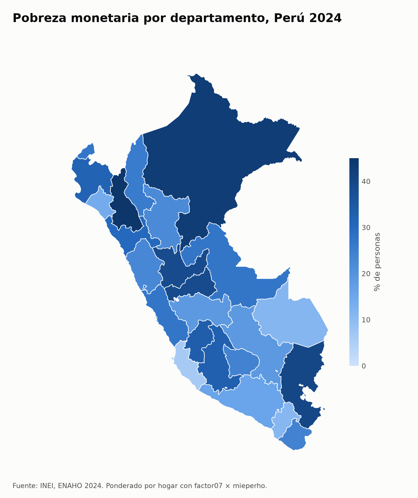

# enaho-skills

Skills de Claude Code que descargan y limpian la ENAHO 2024 del INEI, grafican la pobreza y hacen un mapa por departamento. Un solo pedido, como «Haz un mapa de la pobreza por departamento con la ENAHO 2024», activa las skills que hagan falta y siempre obtiene la misma base.

Proyecto de la [sesión 16](https://github.com/d2cml-ai/Data-Science-Python/tree/main/sessions/16-skills-enaho) de Ciencia de Datos con Python.



## Las skills

| Skill | Entra | Sale |
|---|---|---|
| `descargando-enaho` | Internet | `datos/966-Modulo34.zip`, `datos/966-Modulo02.zip` y el GeoJSON |
| `limpiando-enaho` | Los dos zip | `salidas/personas_2024.parquet` y `salidas/validacion.txt` |
| `graficando-enaho` | La base limpia y un corte: área, sexo o edad | `figuras/pobreza_por_<corte>.png` |
| `mapeando-enaho` | La base limpia y el GeoJSON | `mapas/pobreza_departamento.png` |

Cada skill usa la anterior si le falta su entrada.

## Cómo correrlo

Necesitas [uv](https://docs.astral.sh/uv/) y, para los pedidos en lenguaje natural, [Claude Code](https://code.claude.com/docs/en/overview).

```bash
git clone https://github.com/rodnm/enaho-skills.git
cd enaho-skills
uv sync
```

**Con Claude Code.** Abre `claude` en la carpeta y pide, por ejemplo:

- ¿Cuál fue la pobreza en Cusco en 2024?
- Grafica la pobreza urbana y rural con la ENAHO 2024
- Haz un mapa de la pobreza por departamento con la ENAHO 2024

**Sin Claude Code.** Los mismos scripts, en orden:

```bash
uv run .claude/skills/descargando-enaho/scripts/descargar.py
uv run .claude/skills/limpiando-enaho/scripts/limpiar.py
uv run .claude/skills/graficando-enaho/scripts/graficar.py
uv run .claude/skills/mapeando-enaho/scripts/mapear.py
```

### Los datos

`descargar.py` baja unos 22 MB a `datos/`, carpeta que no se sube a git. Si prefieres bajarlos a mano:

| Archivo | Una fila por | Filas | Factor |
|---|---|---|---|
| [`966-Modulo34.zip`](https://proyectos.inei.gob.pe/iinei/srienaho/descarga/STATA/966-Modulo34.zip), sumaria | Hogar | 33,691 | `factor07` |
| [`966-Modulo02.zip`](https://proyectos.inei.gob.pe/iinei/srienaho/descarga/STATA/966-Modulo02.zip), miembros | Persona | 117,721 | `facpob07` |
| [`peru_departamental_simple.geojson`](https://raw.githubusercontent.com/d2cml-ai/Data-Science-Python/main/sessions/06-geoespacial/lab/Data/peru_departamental_simple.geojson), límites | Departamento | 25 | — |

`966` es el código de la ENAHO 2024 en el portal del INEI. Las skills solo trabajan con 2024, el año con cifras de referencia.

## Validación

`limpiar.py` compara cada corrida con las cifras oficiales y se detiene si algo difiere más de 0.1 puntos. El detalle está en [`salidas/validacion.txt`](salidas/validacion.txt).

| Cifra | Esperado | Obtenido |
|---|---|---|
| Residentes habituales | 108,664 | 108,664 |
| Pobreza nacional | 27.6 % | 27.58 % |
| Pobreza extrema | 5.5 % | 5.50 % |
| Urbana / rural | 24.8 % / 39.3 % | 24.81 % / 39.30 % |
| Lima Metropolitana | 28.2 % | 28.21 % |
| 25 departamentos | Referencia de la sesión | Todos a 0.05 puntos o menos |

## Una diferencia con la regla de la sesión

La sesión pide ponderar los gráficos siempre con `facpob07`, pero sus cifras de referencia salen de la sumaria con `factor07 × mieperho`. Las dos cosas no se pueden cumplir a la vez:

| Peso | Urbana / rural | Departamentos a más de 0.1 de la referencia |
|---|---|---|
| `factor07 × mieperho`, por hogar | 24.81 % / 39.30 % | 0 de 25 |
| `facpob07`, por persona | 24.74 % / 39.44 % | 14 de 25 (Puno 40.42 % frente a 39.9 %) |

Por eso este repositorio usa `factor07 × mieperho` para las cifras nacionales, por área y por departamento, y `facpob07` para sexo y edad, que son atributos de cada persona. Cada figura lo dice en su nota al pie.

## Evaluación

[`evaluacion.md`](evaluacion.md) compara los tres pedidos con y sin skills. Con skills, las salidas son idénticas byte a byte en cada corrida.

## Licencia

[MIT](LICENSE). Cubre el código y las skills. Los microdatos y sus cifras son del INEI.
